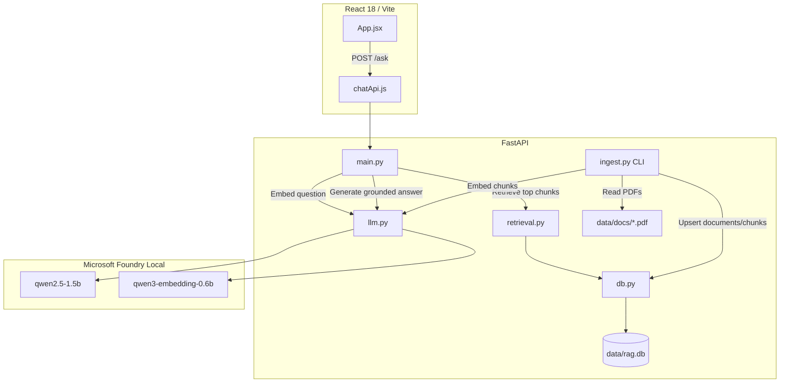

# Architecture Analysis: Local RAG Assistant

This document describes the current implementation and separates implemented behavior from known architectural debt. It should be read together with [README.md](./README.md) for setup and usage instructions.

## 1. Current system architecture



All runtime components are local. The only external dependency needed for model inference is the installed Foundry Local runtime and its locally available models.

## 2. Request and ingestion flows

### Question flow

1. The frontend sends `{ "question": "..." }` to `POST /ask`.
2. `main.py` rejects empty questions and returns HTTP 503 when model warm-up has not succeeded.
3. `llm.py` embeds the question.
4. `retrieval.py` loads all chunks from SQLite and calculates cosine similarity.
5. The three highest-scoring chunks are retained only when their score is at least `0.45`.
6. `llm.py` formats the retrieved chunks as numbered context and asks the chat model to cite factual claims with `[1]`, `[2]`, etc.
7. The API returns the answer and source metadata. `App.jsx` renders citations as buttons that expand the corresponding source chunk.

If no chunks meet the threshold, the chat model receives no document context and is instructed to respond conversationally rather than inventing document facts.

### Ingestion flow

1. `python ingest.py` scans `backend/data/docs/*.pdf`.
2. Each PDF is hashed with SHA-256. An unchanged file is skipped.
3. `pypdf` extracts non-empty pages.
4. Paragraphs are grouped into chunks up to 1,200 characters; chunks shorter than 200 characters are discarded. A paragraph longer than the maximum is hard-split.
5. The embedding model generates one vector per chunk.
6. The document row is inserted or updated, old chunks for that document are deleted, and new chunks are stored with their page numbers and JSON embeddings.

The ingestion CLI is intentionally separate from the web server. There is currently no runtime upload endpoint or background ingestion job.

## 3. Key entry points

- [backend/main.py](./backend/main.py): FastAPI application, CORS configuration, startup model warm-up, shutdown cleanup, `/ask`, and `/health`.
- [backend/ingest.py](./backend/ingest.py): PDF indexing CLI with `--force` support.
- [backend/llm.py](./backend/llm.py): Foundry Local SDK loading, model cache, embeddings, grounded prompt, and chat completion.
- [backend/retrieval.py](./backend/retrieval.py): in-memory cosine-similarity ranking and relevance filtering.
- [backend/db.py](./backend/db.py): SQLite schema and document/chunk access helpers.
- [frontend/src/main.jsx](./frontend/src/main.jsx): React root mount.
- [frontend/src/App.jsx](./frontend/src/App.jsx): chat state, loading/error UI, answer rendering, and source citation interaction.
- [frontend/src/chatApi.js](./frontend/src/chatApi.js): API base URL, request timeout, response parsing, and explicitly marked development fallback.

## 4. API and lifecycle behavior

### Startup and health

The FastAPI lifespan initializes SQLite and calls `warm_up()` for both models. A warm-up failure is logged with a traceback, but the server remains available in degraded mode. `/health` returns:

```json
{"status":"ok","models_ready":true}
```

or the equivalent degraded response with `models_ready: false`. Models are unloaded during application shutdown.

### Error behavior

- Empty questions: HTTP 400.
- Models unavailable: HTTP 503.
- Model inference failure: HTTP 502.
- Frontend network errors or timeouts: an explicitly marked mock response is shown; non-network API and parsing errors are rethrown and displayed as an error state.

The fallback is a UI resilience feature, not an alternative retrieval or generation path.

## 5. Architectural strengths

- **Local-first execution:** document data, embeddings, and chat inference remain on the user’s machine.
- **Grounding contract:** retrieved context is explicitly separated from the chat prompt, and the model is instructed to cite source chunks.
- **Deterministic document refresh:** SHA-256 content hashes avoid unnecessary re-embedding while `--force` supports deliberate rebuilds.
- **Page-aware citations:** page numbers are preserved from PDF extraction through the API response and UI.
- **Explicit readiness state:** model warm-up and `/health` prevent requests from silently running before the models are ready.
- **Clear pipeline boundaries:** ingestion, persistence, retrieval, model integration, and presentation are separate modules.

## 6. Known technical debt and recommendations

### 6.1 In-memory vector retrieval

**Current state:** `retrieval.py` reads every chunk and embedding for every request, then performs an `O(N)` NumPy scan.

**Impact:** Query latency and memory use grow linearly with the number of chunks.

**Recommendation:** Keep the current implementation for small local collections, but introduce a persistent vector index such as FAISS or a SQLite vector extension when the knowledge base grows. The replacement should preserve source filename, page number, and chunk ordering.

### 6.2 JSON-serialized embeddings

**Current state:** `db.py` stores vectors as JSON in a SQLite `TEXT` column.

**Impact:** JSON increases storage size and adds serialization overhead.

**Recommendation:** Migrate to a `BLOB` containing `float32` bytes or let a vector index own the serialized representation. Add a migration path before changing the schema.

### 6.3 Separate CLI ingestion

**Current state:** Users must copy PDFs into `backend/data/docs` and run the CLI manually. The frontend has no upload or indexing progress UI.

**Recommendation:** Add an authenticated upload and ingestion workflow only when the project needs runtime document management. A background job and clear indexing status would be preferable to running embedding work inside a request handler.

### 6.4 Per-operation SQLite connections

**Current state:** Each database helper opens and closes its own connection. This is simple and appropriate for the current single-user prototype.

**Impact:** Repeated connection setup and possible write contention become more noticeable under concurrent workloads.

**Recommendation:** Introduce request-scoped connections or a small database abstraction if concurrent writes or runtime ingestion are added. Preserve explicit transactions around document replacement.

### 6.5 Chunking quality

**Current state:** Chunking is paragraph-based, page-local, capped at 1,200 characters, and has no overlap.

**Impact:** Long paragraphs are split at arbitrary character boundaries and context can be lost across chunk boundaries.

**Recommendation:** Evaluate a recursive splitter with a small overlap and document-level boundary handling. Measure retrieval quality on a representative question set before changing the defaults.

### 6.6 SDK coupling and testability

**Current state:** `llm.py` imports the Windows Foundry Local SDK lazily but owns the model manager and global loaded-model cache.

**Impact:** Unit tests that exercise real inference require the Windows-specific dependency and local model runtime.

**Recommendation:** Define a small provider interface and inject a fake provider in tests. Keep Foundry Local as the production provider without weakening runtime error reporting.

### 6.7 Frontend fallback semantics

**Current state:** `chatApi.js` returns a clearly marked mock answer only for network errors and request timeouts.

**Impact:** This keeps the interface demonstrable when the backend is unavailable, but it can confuse users if the marker is overlooked.

**Recommendation:** Keep the current explicit marker during development; for a production release, consider replacing the mock answer with a retry/error panel so every displayed answer is generated by the configured backend.

## 7. Recommended next architectural steps

1. Add automated tests for chunking, hash-based ingestion skipping, retrieval thresholds, API error status codes, and citation payloads.
2. Add a provider seam around Foundry Local so API tests do not need model downloads.
3. Define an evaluation set of questions and expected source pages before changing chunking or retrieval.
4. Add persistent vector indexing only after the current linear scan becomes measurable bottleneck.
5. Add runtime upload only with file validation, size limits, ingestion status, and a safe replacement transaction.
